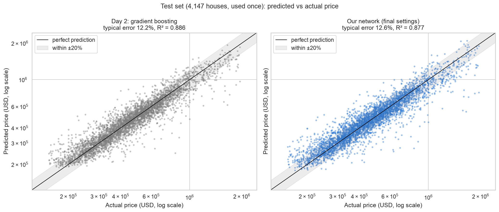
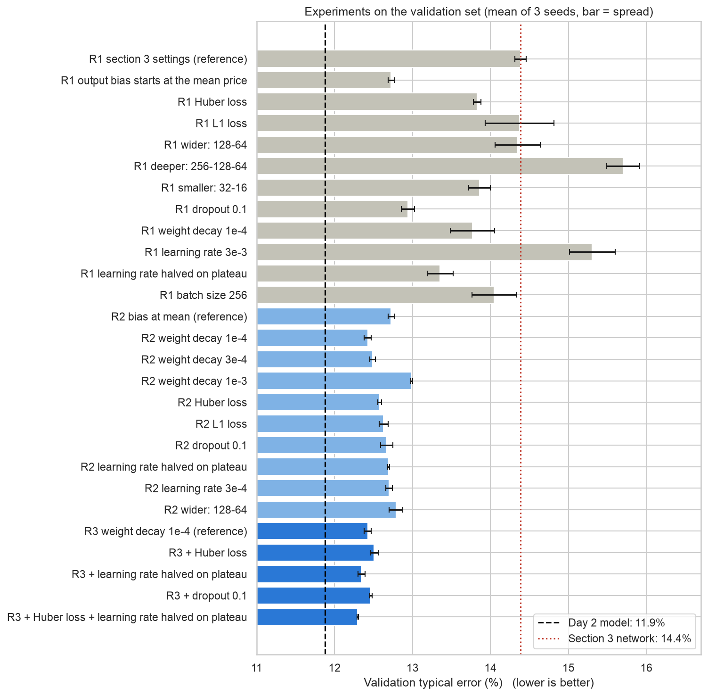
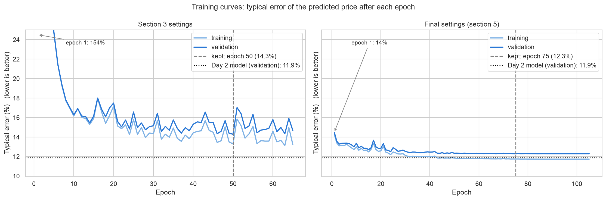
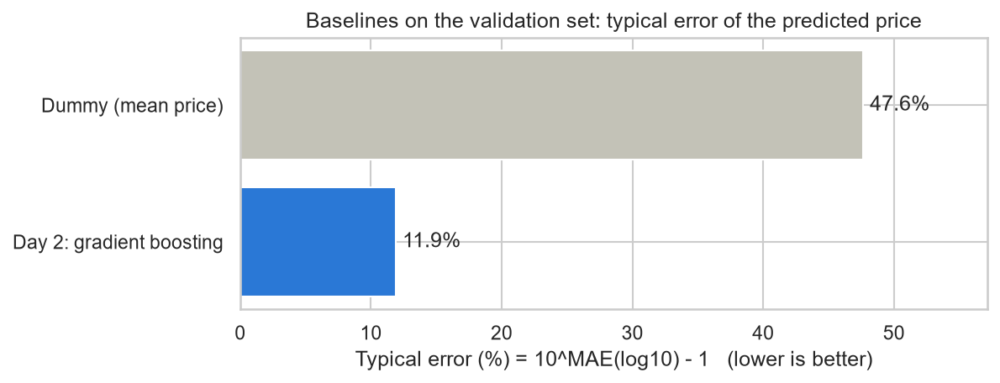
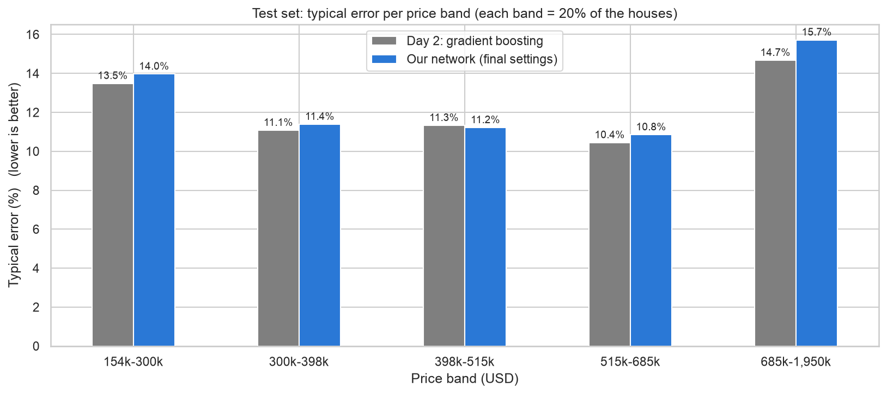

# Predicting King County house prices with a neural network

**Team:** Karthikeyan Saravanan, Emmanuel Marquez, Bars Babila, Samiha Abeda Nur
**Course:** AI Methods I – Day 4: Neural networks and computer vision (IAAC MaAI 2026/27)
**Track:** A1 – MLP on tabular data
**Model on Hugging Face:** TODO (Person 4): `https://huggingface.co/iaac-maai/day4-group2-house-price-mlp`



*On the 4,147 test houses, the network (right) is typically 12.6% off the true price, against 12.2% for our Day 2 gradient boosting model (left). Both follow the diagonal; the largest misses are expensive houses that are under-estimated and a few cheap houses that are over-estimated.*

## Use case

Real estate professionals, buyers and lenders who want a **quick first estimate** of what a house in King County (Washington, USA, including Seattle) is worth, from a few facts about the building and its location, before a full professional valuation. Over-estimating the price can make a buyer overpay or a lender lend too much; under-estimating it can make a seller sell too cheaply. Because an error of 50,000 USD matters much more for a cheap house than for an expensive one, we predict `log10(price)` and judge the model by its **typical error in percent**.

The question of this project: **does a neural network beat our Day 2 gradient boosting model on the same data, inputs and test set?**

## Dataset

| | |
|---|---|
| **Name** | House Sales in King County, USA |
| **Source** | [Kaggle: harlfoxem/housesalesprediction](https://www.kaggle.com/datasets/harlfoxem/housesalesprediction), cleaned in our [Day 1 / Day 2 repository](https://github.com/iaac-maai/2-day2-assignment) |
| **Coverage** | Sales of houses in King County, May 2014 to May 2015 |
| **Size** | 20,703 sales (one row = one sale), 13 input columns; train 13,244 / validation 3,312 / test 4,147 |
| **Target** | `log10(price)` (price in USD), as on Day 2 |
| **Licence** | CC0 1.0 (public domain) |

The test set is **exactly the Day 2 test set** (`GroupShuffleSplit`, 20%, `random_state=42`, grouped by house `id` so that both sales of a house sold twice stay on the same side). The validation set is 20% of the Day 2 training set, split the same way.

## Repository structure

```
├── data/          # cleaned Day 2 CSV, downloaded by the notebook (not committed)
├── figures/       # plots exported by the notebook
├── models/        # model card (README.md) + its figures; model.pt and scaler.joblib live on Hugging Face
├── notebook/      # neural_network.ipynb: the whole pipeline
├── .gitignore
├── LICENSE
├── README.md
└── requirements.txt
```

## How to run

```bash
python -m venv .venv
.venv\Scripts\activate           # macOS / Linux: source .venv/bin/activate
pip install -r requirements.txt
```

Open `notebook/neural_network.ipynb`, select the `.venv` kernel and run all cells. Run it from the `notebook/` folder, because all paths are relative to it. The cleaned data is downloaded automatically into `data/` the first time.

Everything runs on a laptop CPU, no GPU needed: the whole notebook takes about 6 minutes on an Apple M-series laptop, of which about 5 minutes are the 81 training runs of the experiments (section 5). The final network trains in about 20 seconds.

## Approach

- **Inputs:** 13 columns, the same as on Day 2: `bedrooms`, `bathrooms`, `sqft_living`, `sqft_lot`, `floors`, `condition`, `grade`, `sqft_basement`, `yr_built`, `yr_renovated`, `lat`, `long` (standardised) and `zipcode` (one-hot encoded, 70 ZIP codes), giving **82 inputs** to the network. The preprocessing is fitted on the training set only.
- **Baselines** (section 2 of the notebook): a dummy model that always predicts the average price, and our **Day 2 model** (`HistGradientBoostingRegressor`, default settings), retrained on the Day 2 training set. It reproduces our published Day 2 test result (R² = 0.886).
- **Architecture:** a multilayer perceptron, 82 inputs → 64 → 32 → 1 output (`log10(price)`), ReLU after each hidden layer, **7,425 parameters**. The output neuron's bias starts at the average `log10(price)` of the training set (see Experiments).
- **Training:** Adam, learning rate 0.001 halved when the validation error has not improved for 5 epochs, weight decay 1e-4, Huber loss (δ = 0.05), batches of 64, up to 300 epochs. Early stopping keeps the epoch with the lowest **validation typical error** (patience 30); the final network kept epoch 75.
- **Diagnosis** (section 4): the first network (section 3: MSE loss, no bias start) lost **10 of its 32 second-layer neurons** for good: they output 0 for every house. They die in the very first epoch, when the network predicts about 0 for a target of about 5.7 and the first gradient steps are huge.
- **Experiments** (section 5): 27 experiments in three rounds, **changing one thing at a time**, each trained with **3 seeds** (42, 7, 2026) and compared on the validation set (mean ± spread). Round 1 started from the section 3 settings; round 2 from the round 1 winner; round 3 combined what helped. Starting the output bias at the mean price was by far the best single change (14.4% → 12.7%). Weight decay, Huber loss and a learning-rate schedule then brought it to 12.3%. Bigger networks and a larger learning rate made it worse.



*Every bar is the validation error of one setting (mean of 3 seeds; the black line on it is the spread). The experiments brought the network from 14.4% (red dotted line) to 12.3%, but no setting crossed the Day 2 model (11.9%, dashed line).*



*Left: the section 3 settings start at 154% error and then zig-zag around 14-17%. Right: the final settings start at a sensible level and become smooth after each halving of the learning rate. The training error ends only about 0.5 point below the validation error, so there is little overfitting.*

## Results

| Model | R² on log10(price) (test) | Typical error (test) | MAE in USD (test) |
|---|---|---|---|
| Dummy (always the average price) | 0.000 | 47.0% | 196,281 |
| Day 2: gradient boosting | 0.886 | 12.2% | 60,201 |
| **Our network** | **0.877** | **12.6%** | **62,682** |

*Typical error = 10^MAE(log10) − 1: how far, in percent, a prediction usually is from the true price.*



*The Day 2 model is typically 11.9% off the true price on the validation set, against 47.6% for the dummy model: a network has to stay below about 12% to beat it.*

**The answer: no, the network does not beat our Day 2 model, but it comes close.** It is 0.4 point behind on the test set, exactly as on the validation set (12.3% against 11.9%), so the many experiments did not overfit the validation set. For a single house the two models are about equally good: the network is closer to the true price for 48% of the test houses, and both put about 55% of the houses within ±10% and 80% within ±20%. Note that the Day 2 model learned from 16,556 sales, the network from 13,244 (it needs the other 3,312 for early stopping).



*In the middle of the market (300,000 to 685,000 USD) the network is as good as gradient boosting. It loses at both ends, most of all for the most expensive 20% of houses (15.7% against 14.7%).*

TODO (Person 4): one figure showing what the model does (section 7, the application).

## Limitations

- **Period and place:** sales in King County in 2014–2015. The model says nothing about other regions, and prices have changed since.
- **Inherited cleaning:** extreme prices, areas and bedroom counts were removed on Day 1, as were the `waterfront` and `view` columns, so the most unusual and most expensive houses are under-represented.
- **Missing information:** the data has no interior quality, architectural design, neighbourhood amenities or market conditions, which also drive prices.
- **Worse at the ends of the market:** the network is least reliable for houses under about 300,000 USD and over about 685,000 USD (typically 14-16% off), where the training data is thinnest.
- **Special sales:** its largest errors are houses that sold far below what their description suggests (e.g. a new 4,460 sqft house sold for 490,000 USD, predicted at 1.4 million; old houses on very large lots). It cannot recognise unfinished buildings, land deals or distressed sales, so it should not be used to value an atypical property.
- **Not more accurate than a simpler model:** gradient boosting is slightly better, needs no tuning and trains faster. The network is a second opinion, not a replacement.
- TODO (Person 4): what the model should not be used for (application, section 7).

## AI usage disclosure

| | |
|---|---|
| **Tools** | Claude (chat) |
| **Why** | To save time on setup files and to understand errors and unclear concepts |
| **Where** | First drafts of the README and `.gitignore`, debugging, and adapting parts of the class notebook to our data |
| **How** | We wrote the notebook code ourselves following the class notebook. We asked Claude to draft the README and `.gitignore`, then checked and edited them. In some places we asked how to adapt the class code to our dataset, and when a cell failed we asked about the error. We applied the changes ourselves and re-ran the cells |

**Lessons learned:** Claude saved time on routine files and on errors, but we always checked its answers against our own code and the brief.

## License

Code and model released under the [MIT License](LICENSE). The data is CC0 (public domain).
